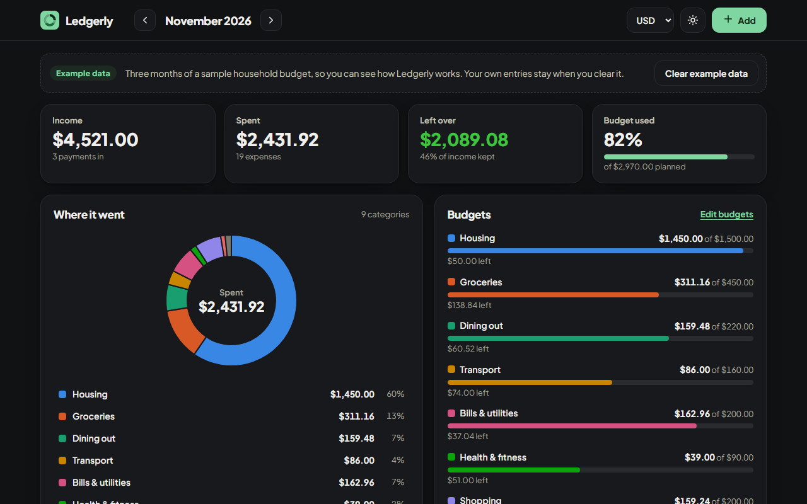

# Ledgerly

See where your money goes each month, without linking a bank or creating an account.

- Add expenses and income by category, with a date and a note; edit or delete them. A deleted transaction can be
  brought back with the Undo button in the message that appears, or with Ctrl+Z (Cmd+Z on a Mac).
- A monthly budget per category, with progress bars and over-budget warnings
- The month at a glance: income, spending, what is left over, and how much of the budget is used
- "Where it went": a spending donut with a legend that filters the transaction list
- A monthly trend of spending by category, with each month's income marked and labelled (also as a table for
  screen readers)
- Import a CSV in Ledgerly's format (date, type, category, amount, note), and export one. Unknown categories are
  created, rows already in Ledgerly are skipped, bad rows are reported.
- 21 currencies (the symbol only: amounts are never converted), light and dark themes that follow the system until
  you pick one
- Starts with clearly labelled example data for three months; one click on "Clear example data" removes it and keeps
  anything you added

Everything is stored in the browser's `localStorage` (and kept in memory, with a note on the page, if the browser
blocks storage). Nothing is sent anywhere.

## CSV format

    date,type,category,amount,currency,note
    2026-11-03,expense,Groceries,84.50,USD,Weekly groceries
    2026-11-15,income,Salary,2100.00,USD,Salary

`date` (YYYY-MM-DD) and `amount` are required; the other columns are optional. Commas or semicolons separate the
columns, and amounts may use a decimal point or a decimal comma. Without a `type` column, a file with negative
amounts is read as signed: negative amounts are expenses, positive ones income.

- A file row that matches a transaction already in Ledgerly (same date, type, category, amount and note) is skipped,
  one for one: importing the same file twice adds nothing, and two identical coffees on one day are both kept.
- When the `currency` column names another currency than the ledger's, the import dialog says so. Amounts are
  imported as they are, never converted.
- Text cells that start with `=`, `+`, `-` or `@` are exported with a leading apostrophe so spreadsheets do not run
  them as formulas.

Ledgerly reads its own column names only (and a few obvious synonyms such as `description` for `note`). It does not
map the many different layouts banks export; rename the columns first if you want to bring in such a file.

## Run, test, lint, build

    npm ci
    npm run dev        # development server
    npm test           # unit tests (Vitest), including the page in a simulated browser (happy-dom)
    npm run lint       # oxlint
    npm run typecheck  # TypeScript, no output
    npm run build      # type-check and build to dist/

Node 22 or later. `dist/` is the folder that is served.

## Project layout

    index.html            the page: top bar, cards, dialogs, toast
    icon.svg              the app icon: listing icon and favicon (Vite copies it into dist/assets)
    listing.json          name, description and category for the app listing
    src/main.ts           wiring: icons, buttons and delegated clicks
    src/state.ts          the ledger, the month and filters in view, save and redraw
    src/deletion.ts       delete and undo
    src/render/           one renderer per part of the page (header, stats, donut, budgets, trend, transactions)
    src/dialogs/          the add/edit transaction, budgets and CSV import dialogs, and CSV export
    src/ui/               charts, icons, theme, tooltip, toast, labels and HTML escaping
    src/lib/              no DOM: the data model and summaries, money parsing and formatting, CSV, storage,
                          example data
    tests/                Vitest tests for src/lib, the charts and the page

## Credits and licences

- Font: Plus Jakarta Sans, SIL Open Font License 1.1, via `@fontsource-variable/plus-jakarta-sans` (the licence
  ships inside that package).
- Interface icons: many are redrawn from the Lucide (ISC licence) and Feather (MIT licence) icon sets.

The licence texts for the icons and the font are in [THIRD_PARTY_NOTICES](THIRD_PARTY_NOTICES).
- Chart colours: a categorical palette validated for colour-vision deficiency in light and dark themes.
- The example data is generated by the app (`src/lib/example.ts`); it describes no real person.

## Licence

MIT © 2026 iSquare Lab
